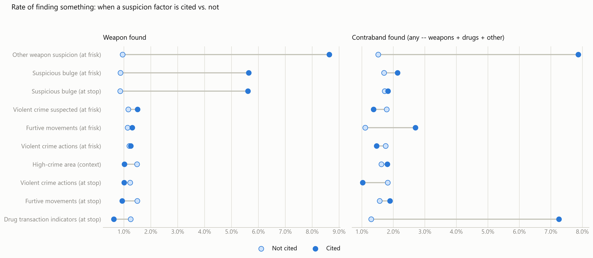
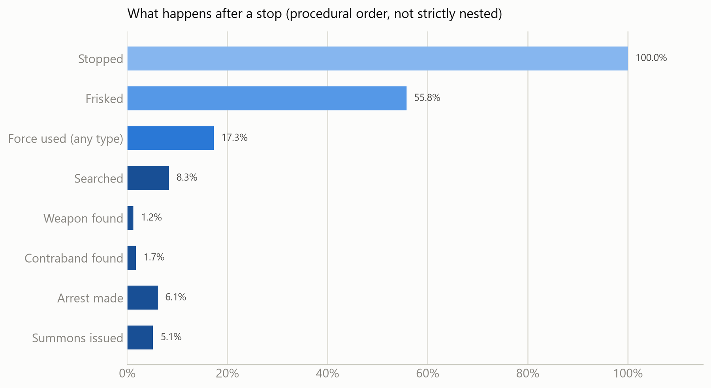
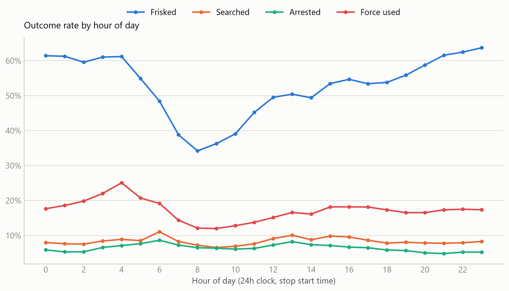
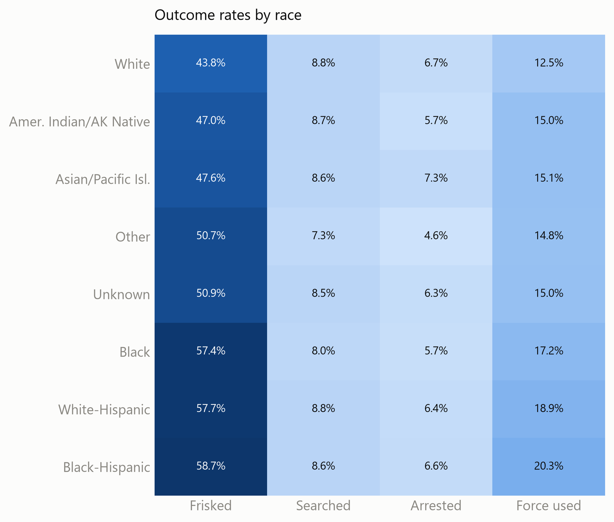
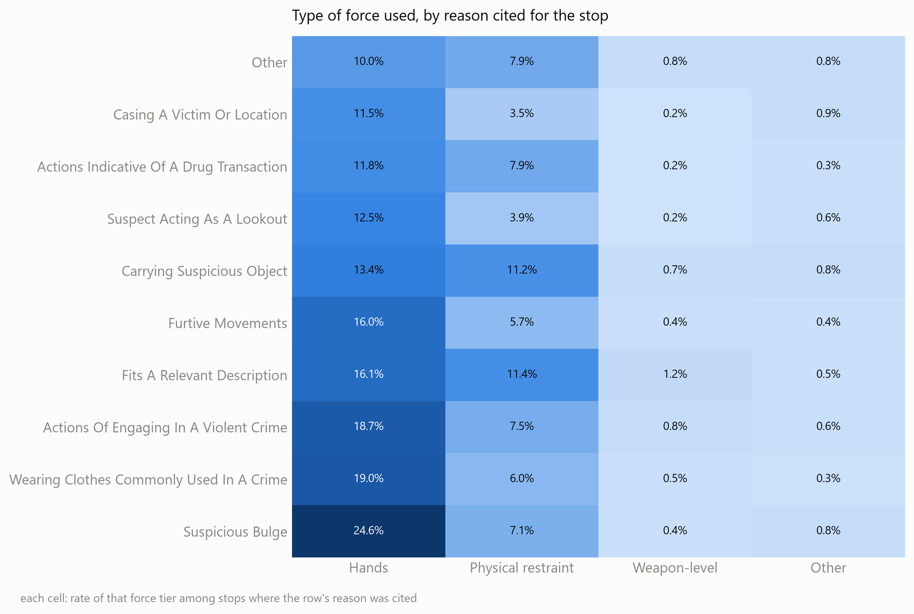
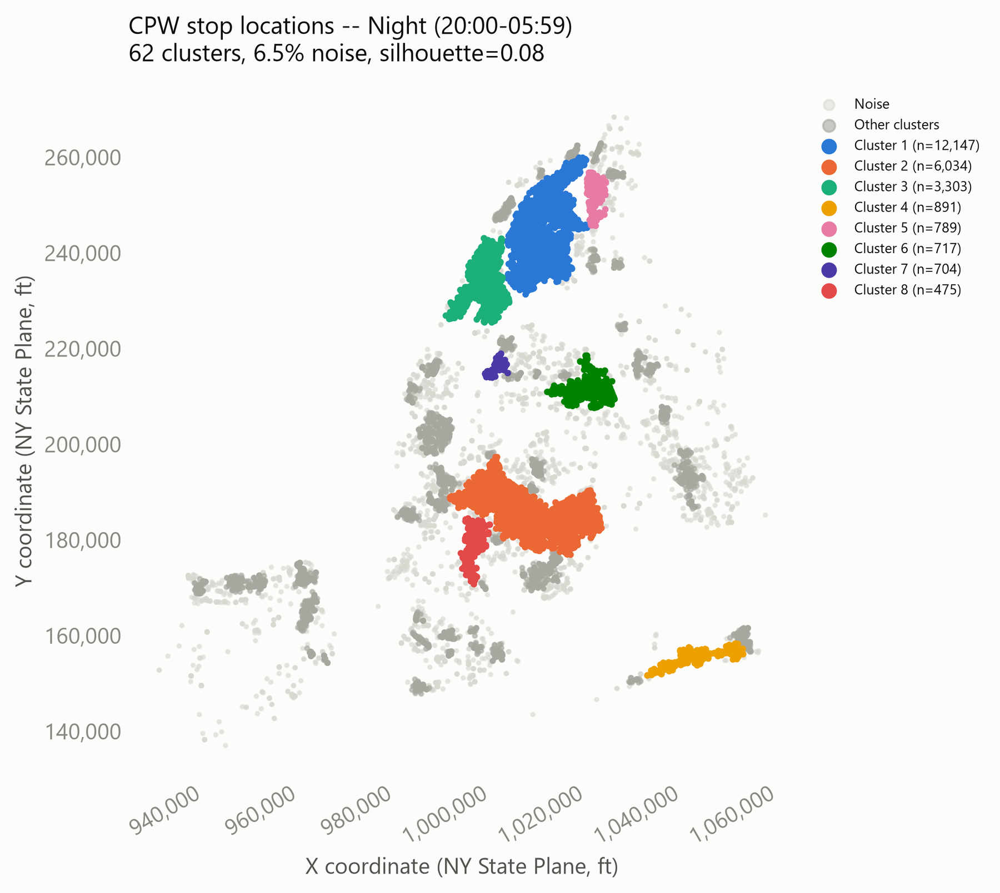
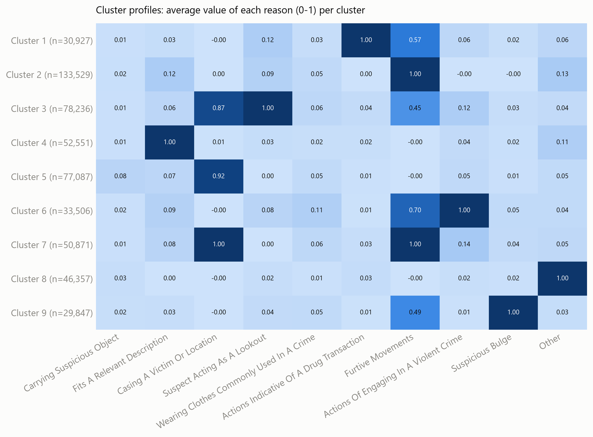
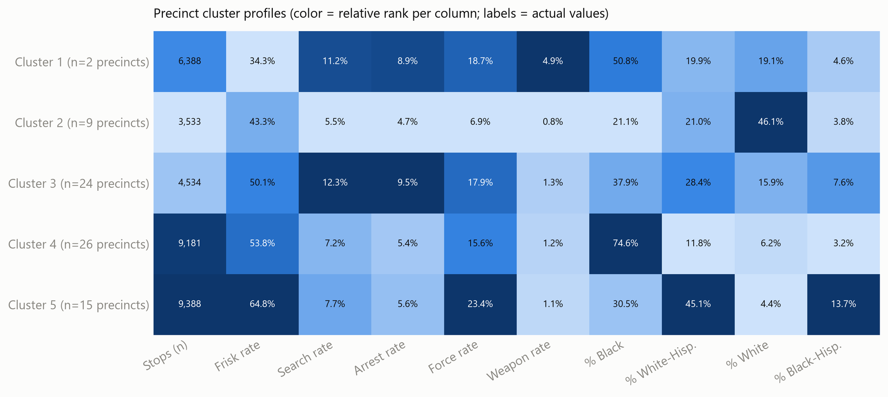
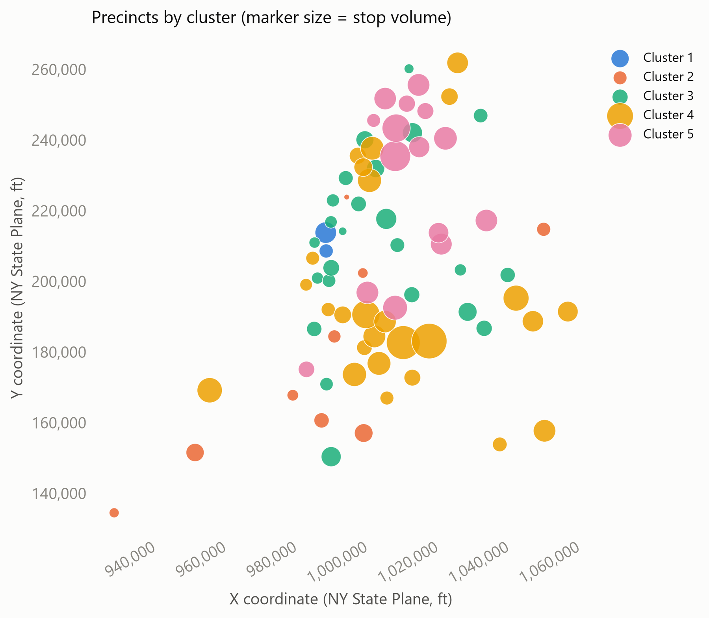
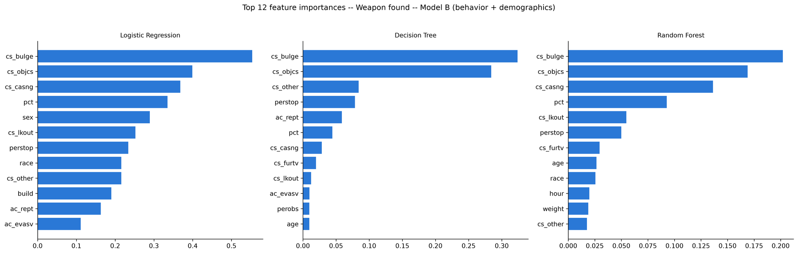

# NYC Stop, Question, and Frisk 2012: Data Cleaning, Clustering, and Prediction (Python)

An analysis of all 532,911 pedestrian stops recorded by the NYPD in 2012 under its Stop, Question, and Frisk (SQF) program, in three stages: understanding and cleaning the data, clustering it (hotspots, reasons for stops, precinct types), and building classifiers to predict weapons found, arrests, and race. The question running through all three stages is whether the reasons officers cite for a stop actually predict what the stop finds. This was a group project for DATA 475 at SAIT, following the CRISP-DM process, and it comes with three written reports.



*Rate of finding a weapon (left) or any contraband (right) when a suspicion factor is cited versus not cited. Narrow, weapon-specific factors (a suspicious bulge, other weapon suspicion) predict a weapon find. The most commonly cited factor, furtive movements, does not.*

**At a glance**

- **My role:** I took this project on myself and directed the whole analysis, working with Claude, which wrote the code. Details in [My role](#my-role) and [How this was built](#how-this-was-built).
- **Skills shown:** data cleaning and validation (including undocumented sentinel values), exploratory analysis and visualization, DBSCAN and K-means clustering with parameter selection when the textbook method fails, classification with Logistic Regression, Decision Tree, and Random Forest, class imbalance handling, data leakage checks, 5-fold cross-validation against a naive baseline, CRISP-DM, written findings and recommendations.
- **Headline findings:**
  - Specificity matters more than frequency. Weapon-specific factors raise the weapon-found rate (other weapon suspicion: about 1% to 8.6%, suspicious bulge: about 5.6%), while furtive movements, cited in 51.5% of stops, shows no lift.
  - Two different methods agree. K-means, given no outcome information, isolated a "suspicious bulge" cluster with a 6.2% weapon-found rate, more than five times any other cluster. Random Forest, Decision Tree, and Logistic Regression all rank the bulge flag as the top predictor of a weapon find.
  - Demographics add almost nothing once behavior is known. Adding race, sex, age, and build to the weapon-found model improved F1 by 0.003 at most.
  - Where race does relate to outcomes, it mostly runs through geography. Precinct clusters range from 5% to 75% Black, while situational factors alone predict race at about chance.
- I also document where my own first attempts failed. See [Things I ran into](#things-i-ran-into) and [Limitations](#limitations).

## What the project contains

| Report | Stage | What it covers |
|--------|-------|----------------|
| 1. Data and Visualization | Business and data understanding | Program background and four effectiveness criteria, data quality audit, descriptive statistics, 14 figures on who is stopped, why, and what follows, suspicion factors vs outcomes, reasons for stop vs type of force |
| 2. Cluster Analysis | Data preparation and modelling | DBSCAN hotspots for weapon-possession stops (day vs night), K-means on the reasons for a stop, K-means on 76 precinct profiles |
| 3. Predictive Modelling | Modelling and evaluation | Three classification tasks (weapon found, arrest made, race), each with three algorithms, a naive baseline, and cross-validation |

The written reports are in [docs/](docs/) (PDF). The code is in [scripts/](scripts/), numbered in the order it runs.

## Questions and findings

| # | Question | What the analysis found |
|---|----------|-------------------------|
| 1 | Who is stopped, and what happens next? | Median age 24, 91.4% male, 53.3% Black. Outcomes narrow at each stage: 55.8% of stops include a frisk, 17.3% any physical force, 8.3% a search, and 6.1% an arrest. Most force is hands-on contact (13.2%). Every weapon-level force type sits at or below 0.2%. |
| 2 | Do the reasons officers cite predict finding a weapon? | Only the specific ones. "Other weapon suspicion" lifts the weapon-found rate from roughly 1% to 8.6%, and a suspicious bulge to roughly 5.6%. Furtive movements, high-crime-area context, and violent-crime factors show no lift or a lower rate. Drug-transaction indicators raise the contraband rate more than fivefold (1.3% to 7.3%), so broad factors may be detecting something else. |
| 3 | Do outcomes differ by race? | Some do and some do not. Frisk and force rates vary (for example 58.7% frisked for Black-Hispanic vs 43.8% for White individuals), while search and arrest rates stay comparatively flat (about 7.3% to 8.8% and 4.6% to 7.3%). |
| 4 | Does force scale with what officers cite? | A suspicious bulge has the highest hands-on rate of any reason (24.6% vs a 13.2% baseline) but does not escalate to weapon-level force (0.4%). |
| 5 | Where do weapon-suspicion stops cluster, and does it change at night? | DBSCAN found 62 night and 50 day hotspots. Night hotspots are tighter (median bounding box 6.9M sq ft vs 9.5M by day). Stop locations reflect where officers patrol, so this cannot separate concentrated activity from a narrower patrol footprint. |
| 6 | Do precincts fall into distinct types? | Five. One two-precinct cluster has the highest weapon-found rate (4.9%) with the lowest frisk rate (34.3%). One 15-precinct cluster has the highest frisk (64.8%) and force (23.4%) rates and the largest Hispanic share. The gap is large enough that a citywide claim needs to say which type of precinct it describes. |
| 7 | Can a weapon find be predicted, and do demographics help? | Modestly. Random Forest F1 is 0.093 against a 0.010 baseline. Adding demographics changes F1 by +0.000 to +0.003. |
| 8 | Can an arrest be predicted? | Yes, mostly mechanically. F1 is 0.51 to 0.53 against a 0.06 baseline, driven by searched, force tier, contraband found, and the basis of search. |
| 9 | Do legitimate situational factors predict race? | Barely. Macro F1 is 0.22 to 0.27 against a 0.25 baseline. Race tracks where a stop happens far more than what happens during it. |

## Data

- **Source:** the NYPD's published [Stop, Question and Frisk data](https://www.nyc.gov/site/nypd/stats/reports-analysis/stopfrisk.page), 2012 file (532,911 records from the UF-250 stop form), plus NYPD's file specification and value-label codebook.
- **Why 2012:** it is one year after the program's peak (685,304 stops in 2011) and before the 2013 *Floyd v. City of New York* ruling forced reform.
- **Anonymization:** the public file contains no names. But every row is a real stop of a real person.
- **The raw data is not stored in this repo.** Download the 2012 CSV and the specification from the NYPD page and place them in `data/` (see [Running it](#running-it)).

## What I changed from the raw file

The data needed extensive cleaning, and none of the issues below are documented in NYPD's codebook. Each one was found by checking the data.

| Issue | Handling |
|-------|----------|
| 6 fields entirely blank (`zip`, `premtype`, `state`, `rescode`, `aptnum`, `othfeatr`) | Dropped |
| `arstoffn`, `sumoffen`, `forceuse` blank when nothing happened | Recoded to an explicit "NONE" |
| Undocumented `*` placeholder in `perstop`, `beat`, `sumoffen` | Recoded to missing. In `beat` it vanishes in Oct to Dec 2012, a clean process change. |
| Age sentinels: 999 (210 rows), and exactly 99 (362 rows) and 100 (77 rows) | Recoded to missing. Each stood out as one value wildly overrepresented next to its neighbors. |
| Birthdate placeholder `12311900` on 40.2% of records | Recoded to missing |
| Race code `U` (3,759 rows) absent from the codebook, which defines `X` for Unknown (never used) | Treated as Unknown |
| Coordinates stored as text | Cast to numeric |
| Officer ID fields blank whenever the officer was in uniform | Derived `officer_id_provided` for plainclothes stops only |

## Results

### Who is stopped, and what happens (Report 1)



*The great majority of stops end without going beyond a pat-down.*



*Frisk and force rates follow a U-shape through the day, highest overnight and lowest in the morning. Search and arrest rates move far less.*



*Frisk and force rates vary by race. Search and arrest rates do not vary as much.*



### Clustering (Report 2)



*Hotspots for stops suspecting criminal possession of a weapon at night (20:00 to 05:59), found with DBSCAN.*



*The nine K-means clusters of stops, described by which reasons were cited. Cluster 9, defined by suspicious bulge, has the highest weapon-found rate (6.2%).*



*Five types of precinct, built from outcome rates and race composition. Geography was not an input.*



*The same clusters plotted by each precinct's mean stop location. They are only partly contiguous, as expected, because clustering used behavior and demographics, not geography.*

### Prediction (Report 3)

| Task | Best model | F1 | Baseline F1 |
|------|-----------|----|-------------|
| Weapon found (behavior only) | Random Forest | 0.093 | 0.010 |
| Arrest made | Random Forest | 0.529 | 0.063 |
| Race, suspicion and evidence only | Random Forest | 0.242 (macro) | 0.249 |
| Race, plus officer response | Random Forest | 0.272 (macro) | 0.249 |

All three real models use `class_weight="balanced"`; the baseline is a stratified random guess. F1 is on the held-out 20% test set. The 5-fold cross-validation scores are within about 0.02 of these (see the reports for full tables).



*Feature importances for the weapon-found model with demographics added. The bulge flag dominates, and race ranks 9th of the ten most important features.*

## Things I ran into

- **Age sentinels hid in plain sight.** An early chart showed a sharp rise in outcomes for people 80 and over. It came entirely from ages 99 and 100, which were placeholders. Checking the underlying counts and combining ages into an 80+ bin removed the spike.
- **The textbook DBSCAN method broke.** A knee search on the k-distance curve returned eps = 4 feet and about 85% noise, because 21.7% of weapon-suspicion stops are recorded at literally identical coordinates. I used the 90th percentile of the k-distance distribution instead, which cut noise to about 6.5%.
- **Silhouette score never plateaued.** On sparse, multi-select binary reason flags it rose steadily from k = 2 to k = 18, which would reward endless fragmentation. I chose k with a knee search on inertia instead (k = 9 for reasons, k = 5 for precincts).
- **99% accuracy, near-zero recall.** Random Forest's first run on weapon-found scored about 99% accuracy with 0.08% recall, because it predicted "no weapon" almost every time. Class weighting and a naive baseline comparison fixed that.
- **A feature importance chart that was wrong.** Precinct looked dominant until the chart code was checked and found to be summing Logistic Regression coefficients across 76 one-hot columns. Averaging them showed precinct was comparable to any single behavioral flag.
- **Leakage in the weapon-found model.** An earlier version excluded `frisked` and `searched` but kept the reason-for-frisk fields, which match `frisked` in 532,908 of 532,911 rows. I removed them before the final figures.

## Limitations

- **One year, citywide, correlational.** Nothing here establishes cause. Clustering describes patterns and does not explain why a precinct or reason profile behaves as it does.
- **Stop data reflects where officers chose to look.** Locations are a product of patrol decisions, not an independent measure of where crime occurs. Findings about hotspots, hit rates, and precincts inherit that limit.
- **"Behavior" is what the officer recorded.** The models treat officer-recorded suspicion factors as the measure of behavior. If those were perceived or recorded unevenly across race, this data cannot show it. Some factors, such as evasive response, involve officer judgment.
- **Weapon-found is hard to predict.** At a 1.2% base rate, the best model has recall near 65% with precision near 5%. It is useful as a diagnostic of which factors matter, not as a screening tool.
- **The race model is an audit, not a tool.** It was built to test whether legitimate factors predict race, and is not meant to be deployed.
- **Small groups.** The two-precinct high-yield cluster and the 91 people aged 80 and over are thin samples, and the reports say so.
- **Conduct figures are self-reported.** The 100% officer self-identification rate (131,848 of 131,852 plainclothes stops) and the 99.93% explanation rate come from the same form used to justify the stop.
- **No effectiveness verdict.** A full judgment would need multi-year data, precinct-level crime statistics, complaint and conviction data, and a comparison condition. Report 1 lays this out.
- **Historical data.** This describes 2012 and may not describe the program or policing today.

## My role

This was submitted as a group project for DATA 475 at SAIT (Group 2), so the reports carry the names of the group members alongside mine. I told the group early on that I would take on this project myself so they could put their time into our DATA 406 capstone report. The analysis, code, and reports in this repo came out of my own working sessions with Claude, described under [How this was built](#how-this-was-built).

## How this was built

I used Claude as a working assistant throughout. Claude Code in VS Code wrote the Python scripts, and Claude drafted the initial versions of all three written reports - from roughly 16 hours of back-and-forth conversation and analysis - in which we examined the data and the results together. I directed the analysis, ran the code, checked the results against the data and against raw rates, and decided what the reports would conclude and how it would be phrased. That checking is how the problems in [Things I ran into](#things-i-ran-into) were caught.

## Running it

```bash
pip install -r requirements.txt

# put the 2012 data in data/ first (see below), then run from the repo root
python scripts/01_load_explore.py
python scripts/02_clean_data.py        # writes data/processed/sqf_2012_clean.parquet
python scripts/03_data_quality.py
# ... continue in numeric order through
python scripts/16_predict_race.py
```

The scripts expect:

- `data/2012 SQF Data.csv`
- `data/2012 SQF File Spec.xlsx` (sheets "SQF2012 File Spec" and "Value Labels")

Script 02 writes the cleaned file that every later script reads. Scripts 08 to 13 and 14 to 16 write figures into `figures/`, which is not tracked by git. The figures in `images/` are the ones used in the written reports. The reports number their figures 1 to n for the reader, while the scripts name outputs in the order they were created, so the two do not match. [docs/figure_map.md](docs/figure_map.md) maps every report figure to the script and file that produced it, explains how the map was made, and lists the script outputs that were not used in the reports.

```
scripts/   numbered Python scripts, plus shared helpers (sqf_data.py, model_pipeline.py, viz_style.py)
docs/      the three written reports (PDF) and figure_map.md
images/    figures from the reports
data/      not tracked, create it and add the NYPD files
```

| Scripts | Stage |
|---------|-------|
| 01 to 07 | Load, clean, audit, data dictionary, summary statistics |
| 08 to 10 | Visualizations, relationships, reasons vs force |
| 11 to 13 | DBSCAN hotspots, K-means on reasons, K-means on precincts |
| 14 to 16 | Predict weapon found, arrest made, race |

## Tools

Python, pandas, NumPy, scikit-learn (DBSCAN, KMeans, Logistic Regression, Decision Tree, Random Forest), Matplotlib, Microsoft Word.

## Data attribution

Data from the NYPD [Stop, Question and Frisk](https://www.nyc.gov/site/nypd/stats/reports-analysis/stopfrisk.page) public data release, 2012. The raw data is not redistributed here. This project is not affiliated with or endorsed by the NYPD.

## More projects

- [Olist marketplace performance analysis](https://github.com/davemcvee/olist-ecommerce-powerbi) (Power BI, DAX, Power Query)
- [LiDAR canopy and terrain classification](https://github.com/davemcvee/lidar-canopy-classification) (Python, PDAL, CloudCompare)
